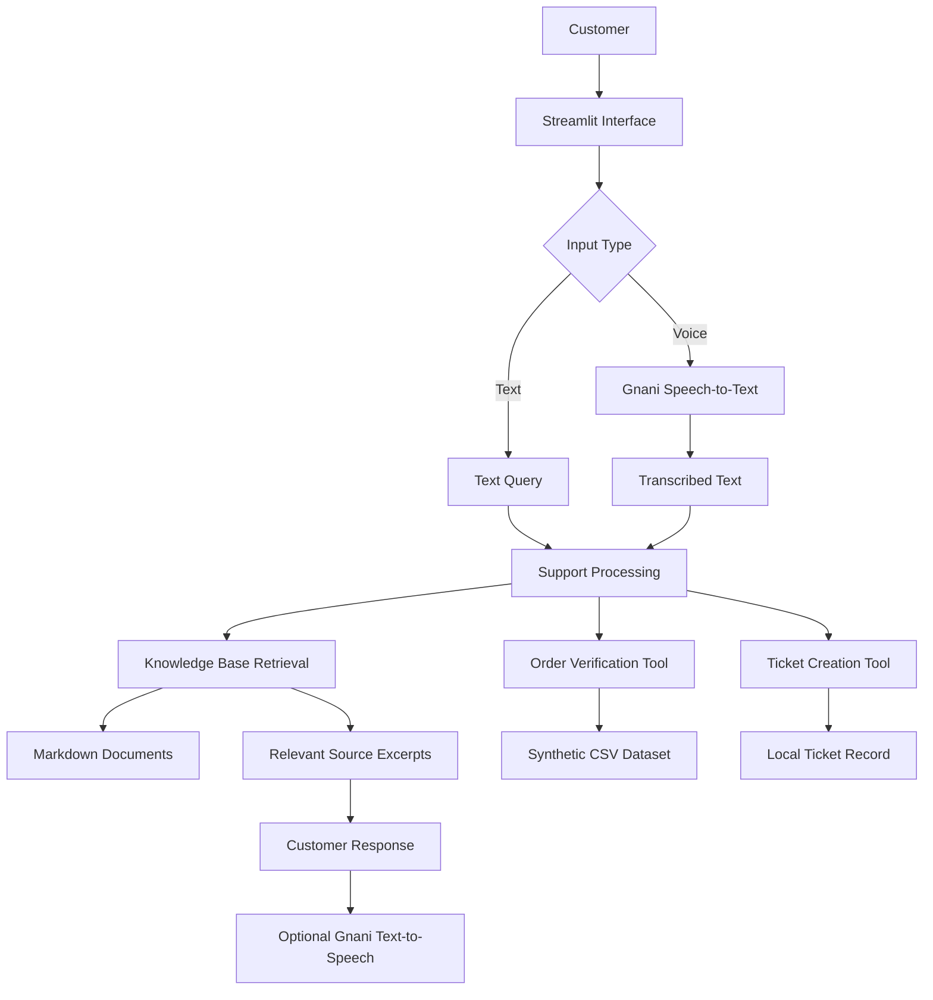

# ZentroMart VoiceOps

### AI-Powered Customer Support Assistant with Voice Interaction, Knowledge-Base Retrieval, and Verified Order Management

<p align="center">
  <strong>A voice-enabled customer support system built using Python, Streamlit, and Gnani AI.</strong>
</p>

<p align="center">
  
  
  
  
  
</p>

---

## 🚀 Live Deployment

**Live Application:** [ZentroMart VoiceOps – Open Application](https://zentromart-voiceops-dwd56au4q2qeqnexdeuaxx.streamlit.app/)

**Source Code:** [GitHub Repository](https://github.com/pratyushmishra9920-ship-it/zentromart-voiceops)

---

## Overview

**ZentroMart VoiceOps** is an AI-powered customer support assistant developed for ZentroMart, a fictional Indian e-commerce company.

The project explores how customer support workflows can be improved by combining voice interaction, knowledge-base retrieval, order verification, and automated support-ticket creation in a single application.

Customers can communicate with the assistant through text or voice. The application transcribes recorded speech using Gnani Speech-to-Text (STT), retrieves relevant information from company knowledge-base documents, and presents supporting information to the customer. It also includes simulated order lookup with identity verification and a support-ticket handover mechanism.

The project was developed as a practical capstone to understand how voice-enabled customer support systems can work with structured business data and unstructured company documentation.

---

## Why I Built This Project

Customer support systems often need to handle several different types of requests:

- Customers asking about returns, refunds, cancellations, and delivery.
- Customers checking the status of their orders.
- Customers communicating in Hindi, English, or Hinglish.
- Customers who prefer speaking instead of typing.
- Requests that require identity verification before sharing private order information.
- Issues that cannot be resolved automatically and need human support.

I wanted to explore how these different workflows could be brought together in one application rather than building another basic chatbot that only responds to predefined questions.

My approach was to combine a structured synthetic e-commerce dataset with a document-based knowledge base, Python-based tools, and voice APIs.

The main objective was to build a demonstrable customer-support workflow while maintaining important safeguards around order information and escalation.

---

## Key Features

### 1. Voice-Based Customer Support

- Record customer messages directly through the application.
- Convert recorded speech into text using Gnani STT.
- Support English (India), Hindi, and Hinglish language selections.
- Display the recognized speech.
- Retrieve relevant knowledge-base information based on the transcription.
- Generate optional spoken responses using Gnani Text-to-Speech (TTS).

### 2. Knowledge-Base Retrieval

- Searches company documents written in Markdown.
- Uses TF-IDF-based text retrieval to identify relevant content.
- Displays matching document sections and their section IDs.
- Preserves source references to help explain where information came from.
- Accounts for policy precedence and superseded documents.

### 3. Order Lookup and Identity Verification

- Uses locally stored synthetic order and customer data.
- Requires a verification step before disclosing order details.
- Supports verification using a registered phone suffix or delivery pincode.
- Prevents disclosure of private order information when verification fails.

### 4. Support Ticket Creation

- Provides a simulated support-ticket handover workflow.
- Records tickets locally.
- Returns a ticket ID when ticket creation succeeds.
- Supports escalation when an issue requires human review.

### 5. Text-Based Customer Support

- Allows customers to type questions directly.
- Retrieves relevant company documentation.
- Supports policy-related questions without requiring order verification.
- Provides a fallback when a request requires human assistance.

---

## Application Architecture

The application combines structured data, unstructured knowledge documents, local Python tools, and external voice APIs.



### Technology Stack

| Component | Technology |
|---|---|
| Programming language | Python |
| User interface | Streamlit |
| Data processing | Pandas |
| Knowledge retrieval | Scikit-learn, TF-IDF |
| Knowledge base | Markdown documents |
| Voice transcription | Gnani Speech-to-Text |
| Spoken responses | Gnani Text-to-Speech |
| API communication | Requests |
| Environment management | Python virtual environment |
| Version control | Git and GitHub |
| Deployment | Streamlit Community Cloud |

---

## Dataset and Knowledge Base

One of the important parts of this project is the supplied **Capstone Project Dataset FTTT 2026**.

Instead of using a small collection of hardcoded chatbot responses, I worked with a synthetic e-commerce dataset containing structured business records and company documentation.

Everything in the dataset is synthetic. ZentroMart is fictional, and no real customer records or recordings are used.

### Dataset Statistics

| Dataset component | Records |
|---|---:|
| Customers | 300 |
| Orders | 1,000 |
| Order items | 1,783 |
| Products | 70 |
| Delivery pincodes | 36 |
| Holidays | 4 |
| Historical support logs | 244 |
| Individual practice questions | 52 |
| Multi-turn conversations | 23 |
| Customer-message turns in conversations | 96 |
| Knowledge-base documents | 21 |

The dataset contains **9 CSV files in total**, including the practice datasets.

### Knowledge Base

The 21 Markdown documents include:

- Company information and agent guidelines.
- Identity verification instructions.
- Escalation and handover procedures.
- Return and refund policies.
- Cancellation and delivery policies.
- Warranty and troubleshooting information.
- Frequently asked questions.
- Hindi-language support material.
- Marketing and membership information.

An important challenge in this dataset is that different documents can contain conflicting information.

For example, an older policy may have been superseded by a newer policy. The application therefore considers document relevance and the source-precedence rules rather than treating every matching document as equally authoritative.

### Dataset Design and Integrity

The dataset also contains relationships between customers, orders, order items, products, and delivery pincodes.

The project uses the supplied mock tools for order lookup and ticket creation rather than directly exposing private fields from CSV records.

A validation script checks:

- CSV structure and required fields.
- Primary and foreign-key relationships.
- Order and item calculations.
- Knowledge-base documents.
- Practice evidence.
- Verification gates.
- Company naming consistency.

**Validation result:** All 9 CSV files, 21 knowledge-base documents, relational checks, order calculations, practice evidence, verification gates, and company naming passed validation.

Run the validator with:

```bash
python validate_dataset.py
```

---

## Project Structure

```text
zentromart-voiceops/
│
├── app.py
├── validate_dataset.py
├── requirements.txt
│
├── data/
│   ├── customers.csv
│   ├── holidays.csv
│   ├── order_items.csv
│   ├── orders.csv
│   ├── pincodes.csv
│   ├── products.csv
│   └── support_logs.csv
│
├── kb/
│   ├── 00_about_this_knowledge_base.md
│   ├── agent_conversation_style.md
│   ├── agent_escalation_handoff.md
│   ├── agent_identity_verification.md
│   ├── faq_general.md
│   ├── faq_hindi.md
│   └── ...
│
├── practice/
│   ├── questions.csv
│   └── conversations.csv
│
├── tools/
│   ├── __init__.py
│   └── tools.py
│
├── README.md
├── DATA_DICTIONARY.md
├── ZIP_SCHEMA.md
├── CHANGELOG.md
└── .gitignore
```

---

## Getting Started

### Prerequisites

- Python 3.10 or later.
- Git.
- VS Code or another Python editor.
- A Gnani API key with the required STT/TTS permissions for voice functionality.

### 1. Clone the repository

```bash
git clone https://github.com/pratyushmishra9920-ship-it/zentromart-voiceops.git
```

```bash
cd zentromart-voiceops
```

### 2. Create a virtual environment

```bash
python -m venv .venv
```

Activate it on Windows:

```bash
.venv\Scripts\activate
```

### 3. Install dependencies

```bash
pip install -r requirements.txt
```

### 4. Configure environment variables

Create a `.env` file in the project root:

```env
GNANI_API_KEY=your_gnani_api_key
```

Do not commit this file or share your API key publicly.

### 5. Validate the dataset

```bash
python validate_dataset.py
```

### 6. Run the application

```bash
streamlit run app.py
```

Open the local application at:

```text
http://localhost:8501
```

---

## Deployment

The ZentroMart VoiceOps application is deployed using **Streamlit Community Cloud** and connected to the project's GitHub repository.

### Live Application

🚀 **[Open ZentroMart VoiceOps](https://zentromart-voiceops-dwd56au4q2qeqnexdeuaxx.streamlit.app/)**

### Deployment Configuration

| Setting | Configuration |
|---|---|
| Hosting platform | Streamlit Community Cloud |
| Source repository | GitHub |
| Repository | `zentromart-voiceops` |
| Branch | `main` |
| Main application file | `app.py` |
| Python version | 3.11 |
| Dependencies | `requirements.txt` |

### Environment Secrets

The Gnani API key is configured through Streamlit Community Cloud's **Advanced Settings → Secrets**.

```toml
GNANI_API_KEY = "your_gnani_api_key"
```

The actual API key is stored in Streamlit Secrets and is not included in the public GitHub repository.

### Deployment Notes

- The application is connected to the GitHub repository.
- Updates pushed to the configured branch can be deployed through Streamlit Community Cloud.
- Voice functionality requires valid Gnani API credentials and internet connectivity.
- The application uses synthetic capstone data for demonstration purposes.
- Local ticket records are not guaranteed to persist across hosted application restarts.

---

## Voice Integration

Voice functionality is implemented using Gnani's Vachana APIs.

The current application uses:

- **Speech-to-Text:** Recorded customer audio is submitted to Gnani STT and converted into text.
- **Text-to-Speech:** An optional spoken response can be generated using Gnani TTS.

The voice workflow is integrated with the same support-processing and knowledge-retrieval flow used by text queries.

The current implementation uses the documented REST API endpoints. The original capstone dataset describes a WebSocket-based STT and streamed TTS workflow, so the current REST implementation should be considered an implementation variation rather than a claim that the WebSocket requirement has been completed.

Voice functionality has been tested in the local application and the deployed application. However, Gnani STT has experienced intermittent HTTP 504 service timeouts, so availability is not guaranteed.

Voice features require internet connectivity and valid API access. Text-based support and local dataset tools can be tested independently.

---

## Testing and Current Implementation Status

The following functionality has been tested during local development and deployment.

| Feature | Status |
|---|---|
| Dataset validation | Passed |
| Knowledge-base retrieval | Tested |
| Text-based customer support | Working |
| Voice recording | Tested |
| Gnani speech transcription | Implemented; intermittent API timeout (HTTP 504) |
| Recognized speech displayed | Tested when STT succeeds |
| Knowledge retrieval from voice transcription | Tested; response relevance needs further improvement |
| Optional spoken response | Tested (REST-based TTS) |
| Order lookup | Working |
| Identity verification | Working |
| Support ticket creation | Working |

These results describe the capstone demonstration. They do not represent production deployment or real customer authentication.

---

## Important Security and Project Limitations

- ZentroMart and all supplied customer and order records are fictional.
- Order lookup and identity verification use synthetic data and are not production-grade authentication.
- Ticket creation is a local mock implementation, not a live company support system.
- Knowledge retrieval displays relevant source excerpts; it should not be mistaken for a fully autonomous, production-grade AI reasoning system.
- Voice functionality depends on Gnani API availability, internet connectivity, and API permissions.
- API credentials must remain outside the public repository.
- The application has not been validated for real customer traffic or production security requirements.
- The deployed application is intended for demonstration and educational purposes.

---

## What I Learned and Explored

Through this project, I explored several practical aspects of building an integrated customer-support application:

- Working with structured CSV datasets and relational data.
- Understanding primary keys, foreign keys, and data validation.
- Building a document-based knowledge retrieval system.
- Using TF-IDF for text retrieval.
- Integrating external Speech-to-Text and Text-to-Speech APIs.
- Connecting voice input with an existing text-processing workflow.
- Implementing verification gates before disclosing order information.
- Designing a support escalation workflow.
- Managing environment variables and API credentials.
- Testing application components independently.
- Using Git and GitHub to manage a complete project.
- Deploying a Streamlit application through GitHub.

Most importantly, this project helped me understand that building a useful support assistant involves more than connecting a language or voice API. It also requires reliable data, clear business policies, verification rules, source handling, and a controlled escalation process.

---

## Future Improvements

Some areas I would like to explore further:

- Implement the original WebSocket-based STT and streamed TTS workflow.
- Improve retrieval using semantic embeddings and hybrid search.
- Add a more structured response-generation layer with stronger source grounding.
- Improve multilingual handling for Hindi and Hinglish.
- Improve intent detection for requests such as order tracking and returns.
- Add analytics for support queries, ticket categories, and resolution patterns.
- Integrate a persistent ticket database.
- Improve hosted application reliability and voice-service error handling.
- Evaluate retrieval quality using the supplied practice questions and conversations.

---

## Repository

**Project:** ZentroMart VoiceOps  
**Developer:** Pratyush Mishra  
**GitHub:** [@pratyushmishra9920-ship-it](https://github.com/pratyushmishra9920-ship-it)  
**Repository:** [zentromart-voiceops](https://github.com/pratyushmishra9920-ship-it/zentromart-voiceops)  
**Live Demo:** [ZentroMart VoiceOps](https://zentromart-voiceops-dwd56au4q2qeqnexdeuaxx.streamlit.app/)

---

<p align="center">
  <strong>Built as a practical capstone project exploring voice-enabled customer support, knowledge retrieval, and secure business workflows.</strong>
</p>